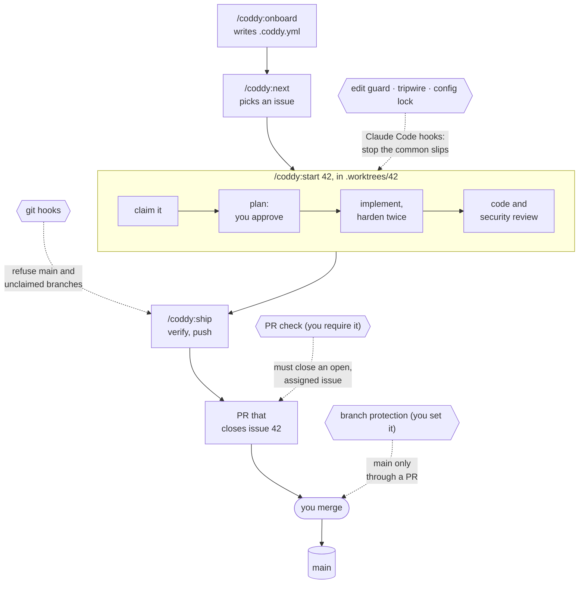

<p align="center">
  
</p>

# coddy

[
](https://github.com/mnsami/coddy/actions/workflows/ci.yml) [![release][rb]][r]

[r]: https://github.com/mnsami/coddy/commits/main/.claude-plugin/plugin.json
[rb]: https://img.shields.io/github/package-json/v/mnsami/coddy?filename=.claude-plugin%2Fplugin.json&label=release
coddy is an issue-driven workflow for Claude Code. Every change Claude makes is tied to a claimed issue,
lives in its own worktree and lands through a pull request. The tracker holds the state. The plugin holds the habits.

- Hooks stop the common slips, and report many shell writes after they happen.
- They are not a sandbox. On GitHub and GitLab, two layers you set by hand ([branch protection and the required PR
  check](#how-it-enforces)) send every change to the default branch through a PR that closes an open, assigned issue,
  if [their settings](#how-it-enforces) are right. Jira has branch protection alone.
- Install: `claude plugin marketplace add mnsami/coddy`, then `claude plugin install coddy@coddy` ([more](#install)).
- The flow: `/coddy:onboard` → `/coddy:next` → `/coddy:start <issue>` → `/coddy:ship`.

```text
> add a Develop section to the README

⏺ Update(README.md)
  ⎿  PreToolUse:Edit hook error: [bash "…/coddy/scripts/issue.sh" guard]:
     coddy: edits belong in an issue worktree, not the main checkout.
     Run /coddy:start <issue>, then edit under .worktrees/<issue>/.

> /coddy:start 42

⏺ #42 is In Progress in .worktrees/42. Run /coddy:ship when done.
```

The edit in the main checkout is rejected. After `/coddy:start`, the same edit under `.worktrees/42/` goes through.

## Install

```bash
claude plugin marketplace add mnsami/coddy   # or a local path to this repo
claude plugin install coddy@coddy
```

For another agent (Codex, Cursor, Copilot CLI, Gemini CLI or Antigravity CLI) or your own terminal:

```bash
curl -fsSL https://raw.githubusercontent.com/mnsami/coddy/main/get.sh | bash
```

- It clones `main` into `~/.coddy` and links `coddy` into `~/.local/bin`. A rerun fast-forwards it,
  and stops on local changes to tracked files. Your agent reads `~/.coddy/skills/`, starting with `onboard/SKILL.md`.
  The plugin keeps its own copy.
- `coddy doctor` says which install runs. In a project it lists what is missing or off. It changes nothing.

coddy runs on macOS, Linux and WSL. As a plugin it needs the Claude Code CLI: claude.ai and Cowork do not
install a plugin with a top-level `bin/`. [Native Windows](docs/enforcement.md#native-windows) is not supported.

You need:
- bash 3.2 or later, and `git`. The hooks find them [on `PATH`, outside the project](docs/enforcement.md#bash-and-path).
- `jq`. The edit guard refuses every edit without a working one.
- `jj` ([Jujutsu](https://jj-vcs.github.io)), only for `worktree: jj`. The default, `worktree: git`, needs nothing more.
  `/coddy:onboard` installs a missing `jq` or `jj` through a shell command you allow. Declining `jq` stops it.
  `jj` has no apt-get package, so there it names the install page.
- For GitHub, GitLab or Jira: the GitHub, GitLab or Atlassian plugin, enabled and signed in.
  Its MCP tools reach the tracker, so none needs a CLI. The GitHub token must read and write issues and PRs.
  The PR check runs `gh` (GitHub) or `curl` (GitLab) inside CI.
- GitLab: as shipped, the plugin reaches gitlab.com only. A self-managed instance needs an MCP server
  configured for that instance, whose tools the skills' `allowed-tools` do not pre-approve, so its calls prompt.
  The config names no host.

## Quick start

Run these inside your project. Each skill also starts from plain language ("start issue 42", "ship it").
1. `/coddy:onboard`: a wizard that writes `.coddy.yml`. Run it once per project.
2. `/coddy:next`: recommends an issue to work on.
3. `/coddy:start <issue>`: claims the issue, gives it a worktree, then plans, implements and reviews it with you.
4. `/coddy:ship`: runs `verify`, pushes and opens the PR. Merge it. The next `/coddy:next` or `/coddy:start` cleans up.



## Skills

| Skill | What it does |
|---|---|
| `/coddy:onboard` | Wizard that writes `.coddy.yml`, the PR check and an `AGENTS.md` block. Run once. |
| `/coddy:next` | Recommends the next issue, skipping ones in progress, assigned to others or claimed here. |
| `/coddy:start <issue>` | Claims it (In Progress), makes `.worktrees/<issue>`, plans with you, implements, reviews. |
| `/coddy:ship [issue]` | Runs `verify`, commits, pushes and opens the issue's PR. |
| `/coddy:drop <issue>` | Gives a claimed issue up and keeps its branch. |
| `/coddy:refresh` | After a merge, updates the other claimed worktrees from the default branch. |
| `/coddy:triage` | Turns findings into issues, skipping ones already open. |
| `/coddy:config [key=value]` | Shows `.coddy.yml` or changes the keys you name. |
| `/coddy:migrate` | Brings the config to the current `version`, moving `.claude/coddy.yml` to `.coddy.yml`. |

- `/coddy:onboard` is a seven-step wizard that saves your answers, so a run that stops resumes. It assumes one
  remote, `origin`, that you can write to, and write or triage access to the tracker's repository.
  Forks are not supported yet (#280). On GitLab it opens a merge request for the check. Jira gets none.
- `/coddy:start` reviews until nothing at `review_block` or above is left or `review_rounds` rounds have run,
  then hands the rest to you. Rerun it to resume. `onto <base-issue>` starts from that issue's branch.
- `/coddy:ship` commits tracked changes and only the untracked files you name. Any other untracked file stops it.
  Under `onto` the PR targets the base issue's branch.

In Progress is the `in progress` label (Jira: the workflow status). Opening the PR ends it (Jira: In Review).
After a merge, the next `/coddy:next` or `/coddy:start` removes the issue's worktree, claim and local branch
([what each keeps, skips or moves](docs/enforcement.md#sweep-drop-and-refresh)).

## Confidential issues

A confidential GitLab issue, or a Jira ticket with a security level, is hidden. Its branch, commits and PR are not.
So `/coddy:start` first proposes a cover, written without the issue's words: the branch name, one commit subject
(used for every commit and as the PR title), one line of description and a list of what goes public.
Nothing is created until you approve it, and `/coddy:ship` stops on such an issue that has none.
A GitLab internal note or a Jira comment restricted to a group or role is never quoted in public text.
The plan and questions `/coddy:start` posts on that issue are internal too. Ceilings:
- The diff itself is public once pushed: the cover hides the issue's words, not the change.
- Ideas `/coddy:triage` files from that work are not covered: it files them as issues that are not confidential.
- Commits already on a branch from before the cover keep their messages, which are public once pushed.

## How it enforces

[docs/enforcement.md](docs/enforcement.md) has one section per layer: what it stops, lets through and misses.
The edit guard, tripwire and config lock are Claude Code hooks. Another agent running the skills from `~/.coddy`
gets only the git hooks, branch protection and the PR check.
- **Edit guard.** Rejects Claude's file edits in the project outside `.worktrees/<issue>/`, and inside it before
  the issue is claimed. `.claude/` stays editable, settings files too
  ([only Claude Code's prompt holds them](docs/enforcement-limits.md#settings-files)), except `.claude/worktrees/`.
  Files outside the project pass. A claim is a lock under `.git/coddy`, and a shell command can rewrite it.
  The assignee check is a `/coddy:start` step. `claim` never reads the tracker.
- **Shell tripwire.** Compares the main checkout before and after each shell command and reports what changed.
  A new worktree outside `.worktrees/` and `.claude/worktrees/` is reported after it is made.
  It does not read the command, so it refuses no push.
- **Config lock.** Undoes a shell command that removes or rewrites `.coddy.yml`, the switch for all of this.
- **Git hooks.** `/coddy:start` installs a `pre-commit` and a `pre-push` that refuse the default branch
  and any branch no claimed issue owns. `--no-verify` skips them, and jj runs none.
  A force push of a claimed branch passes. Its delete is not refused yet (#269).
- **Branch protection.** You set it. It holds when a command edits, commits and pushes in one go.
  With the `pre-push` hook it holds a push to the default branch. Under jj it holds it alone.
- **PR check.** A GitHub Action, or a GitLab job, that fails a PR unless it closes an open, assigned issue.
  You require it. It holds for a cloud agent, or a branch coddy did not name. Jira has none.

Branch protection and the PR check hold only with these ([details](docs/enforcement.md#what-the-hard-layers-need)):
- No token the agent can use may change repository settings. GitHub: no Administration write. GitLab: below Maintainer.
- A required approving review, with stale approvals dismissed on a new push. onboard asks for neither.
- A required code-owner review on every CI file, since a PR can edit the check's own workflow: `.github/workflows/`
  (GitLab: `.gitlab/`, `.gitlab-ci.yml` and every file it includes). GitLab needs Premium for it.
- A plan that offers them: a private GitHub repository needs Pro, Team or Enterprise. Without one, only hooks hold.

If the hooks keep refusing, see the [three ways out](docs/enforcement.md#three-ways-out).

## Config

`.coddy.yml` at the project root, written by `/coddy:onboard` and changed by `/coddy:config`:

```yaml
version: 2                   # schema version; set by /coddy:onboard and /coddy:migrate
tracker: github              # github | jira | gitlab
repo: owner/name             # github: owner/name; gitlab: the full project path, group/subgroup/project
# jira:                      # jira only, in place of repo
#   site: https://acme.atlassian.net
#   project: KEY
worktree: git                # git (default) | jj
default_branch: main
branch: "{type}/{issue}-{slug}"
commit: "{type}({issue}): {summary}"
verify: "make check"         # must exit 0 before /coddy:ship opens the PR
roadmap: docs/ROADMAP.md     # optional; /coddy:next reads it
guard: block                 # optional; block (default) | warn
tiers:                       # model per difficulty, per agent; start picks one per issue
  claude: {low: haiku, medium: sonnet, high: opus}
review_block: high           # optional; critical | high | medium | low (default high)
review_rounds: 3             # optional; 1-5 (default 3)
```

- `worktree` is `git` (`git worktree add`, the default) or `jj` (`jj workspace add`, colocating the repo on first use).
  Below version 2, an absent key means `jj`. `/coddy:config` refuses to switch it while an issue worktree exists.
- `guard: warn` turns the edit guard's rejections into [notices](docs/enforcement.md#guard-warn).
  Set it with `/coddy:config guard=warn`.
- A config without `version` is read as version 0. One at `.claude/coddy.yml` is read while `.coddy.yml` is absent.
  `/coddy:migrate` updates either. Every skill but `/coddy:onboard` refuses to run without one.
- To leave the workflow, [follow these steps](docs/enforcement.md#leaving-the-workflow) from your own terminal.

## Related projects

- [super-board](https://github.com/EricTechPro/super-board) drains a Projects board; a lane can run `/coddy:start`.
- [Vibe Kanban](https://www.vibekanban.com/) and [CCPM](https://github.com/automazeio/ccpm) launch several agents.
  coddy launches none. It keeps Claude's Edit and Write tools and `/coddy:ship`'s push off another session's claimed
  worktree. Shell commands are not held.
- [chock](https://github.com/open-coder-ai/chock) blocks dangerous commands. coddy covers the workflow.

## Contributing

- Collaborators: pick an open [issue](https://github.com/mnsami/coddy/issues) and work it through coddy itself.
  The config is personal: run `/coddy:onboard` in your clone first. Others open a PR by hand with `Closes #<n>`.
- Commits are `type: summary` (`feat`, `fix`, `chore`). The PR must close its issue (`Closes #<n>`).
  The first three commands under [Develop](#develop) pass before you open it.
- A release is a version bump of `.claude-plugin/plugin.json`, in a PR of its own. An installed copy changes only
  after a bump. PRs merge with a merge commit, never squash or rebase, so stacked PRs keep their base's commits.

## Develop

```bash
bash scripts/selftest.sh                 # the Claude Code shims end to end, in a throwaway repo
bash scripts/selftest-core.sh            # bin/coddy on its own inputs, with no CLAUDE_* set
claude plugin validate .                 # manifest and skill frontmatter
claude --plugin-dir . -p "/coddy:next"   # run one skill headless against the working copy
```

A headless run needs `--allowedTools` for the edit tools and `Agent`, and `Skill(coddy:<name>)` for a plain trigger.
