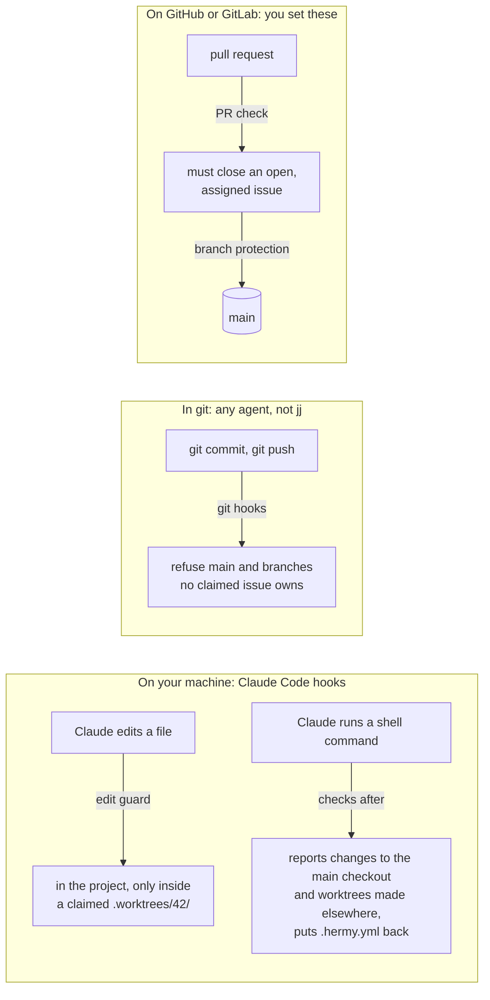

# How hermy enforces its rules

This page says what each layer stops, what it lets through and where it falls short.
The [README](../README.md) has the short version.

The diagram is the short form. Each layer's section has what it lets through and where it falls short.
The last section, sweep, drop and refresh, is not a layer. It sits here because its ceilings have no better page.

Each layer has the same rows. A row is left out when it does not apply.

- **Stops:** what the layer refuses or reports.
- **Lets through:** what it leaves alone on purpose.
- **Asks you first:** what needs your yes.
- **Always refuses:** what it refuses in both `guard` modes.
- **Doesn't catch:** its gaps.
- **When it blocks you:** how to get unblocked.
- **Needs:** what must be installed or set.

## What holds against what

- The hooks stop the common slips, such as editing in the main checkout.
  git's `pre-push` hook stops a push to the default branch. Under jj, which runs no git hooks,
  nothing local does: branch protection alone holds it.
- The hooks also report many shell writes after they happen.
- They are not a sandbox. An agent that is set on getting round them can.
- On GitHub and GitLab, two layers you set by hand make every change to the default branch go through a PR
  that closes an open, assigned issue: branch protection and the required PR check.
  They hold only with the settings in "What the hard layers need" below.
- On Jira there is no PR check, so branch protection is the only hard layer.
- Claims are cooperative. A shell command that writes to `.git/hermy` defeats
  "only the claiming session may edit or push".
- `start`'s sub-agents run in the parent's session. Their edits count as the session's own.
- The tracker check is a step in `/hermy:start`. It reads the issue and refuses one assigned to someone else.
  `claim` never reads the tracker. It records what the skill did.
- The review the PR shows is what `/hermy:start` reports. Any command in the owning session can set it.

## When hooks fail or are off

### A hook fails

- The edit guard and the shell check block a call by exiting 2.
- A hermy crash in either also blocks. Every edit and shell command is refused, under `guard: warn` too,
  until you update, reinstall or disable the plugin.
- From Claude Code 2.1.295 a timeout, or a hook that cannot start, blocks too. Before 2.1.295 that call goes through.
- Timeouts: 10 seconds for the edit guard, 60 for the shell check.
- The shell check gets 20 seconds to record the state of the main checkout.
  Past that the command runs, and Claude is told it went unchecked.
- The other hooks never block on a failure.

### Three ways out

- Run the command from your own terminal.
- Disable the plugin: `claude plugin disable hermy@hermy`.
- Start a session with every hook off: `claude --settings '{"disableAllHooks": true}'`.

### Hooks off

- Claude Code before 2.1.139 runs none of the hooks. Only the git hooks, branch protection and the PR check hold.
- Where `/usr/bin/env` or `/bin/sh` is missing, the hooks cannot start, on any OS.
  From Claude Code 2.1.295 that refuses every edit and shell command, so disable the plugin there.
- Claude Code runs no plugin hook when `disableAllHooks` is set, in any settings file or by `--settings`.
- It runs none under managed settings that set `allowManagedHooksOnly`.
  An admin who wants managed hooks alone keeps hermy's by force-enabling `hermy@hermy` in the managed `enabledPlugins`.
- With the hooks off, the edit guard, the tripwire and the config lock are off.
  Only the git hooks, branch protection and the PR check hold.
- The edit guard, the tripwire and the config lock are Claude Code hooks.
  Another agent that runs the skills from `~/.hermy` (Codex, Cursor, Copilot CLI, Gemini CLI, Antigravity CLI)
  never has them. It gets only the git hooks, branch protection and the PR check.
- Each shell hook leaves a mark for its session. `/hermy:start` looks for it before it creates or claims the worktree.
  With none, it prints `hooks: off` and the causes, and asks you before it claims the issue.
- That check reads the session's own mark. A session with its hooks off is caught only when it runs `/hermy:start`
  itself, and a shell command can make the mark. It is a check, not a guardrail.

## Platform

### bash and `PATH`

- The hooks start under `/bin/sh`. They run the first `bash` on Claude Code's `PATH`. bash 3.2 or later works.
  On macOS that can be `/bin/bash`.
- They look for `bash`, `git`, `jq` and `jj` on that `PATH`.
  They skip every entry that is empty, relative, or inside the project, through a link or not.
  A command could plant a tool there, and the hooks run outside the sandbox.
- So a toolchain that lives only in the project (`.venv/bin`, devbox, nix-shell) does not count.
- With no `bash` left, every call is refused.
- With no `git` left, every shell command is refused.
  So is every shell command with no `jj`, where the project holds a `.jj`.
- With no `jq`, every edit is refused.
- `hermy doctor` prints the `bash` the hooks run.
- Set in a `.claude/settings.json` or `settings.local.json` `env`, these still reach the hooks:
  `LD_PRELOAD`, `LD_AUDIT`, `TMPDIR`, `JJ_CONFIG` and an absolute `PATH` entry outside the project.
  So does a function exported into your own environment that is named like a builtin (`cd`, `pwd`, `printf`),
  on macOS, where `/bin/sh` is bash.

### Native Windows

- Git Bash, MSYS2 and Cygwin are not supported. Use WSL.
- The hooks cannot start there. From Claude Code 2.1.295, that refuses every edit and shell command.
  Disable the plugin there. Before 2.1.295 nothing is guarded.
- Where bash itself runs on native Windows, the edit guard refuses every edit.
- `/hermy:onboard` stops. `hermy doctor` exits 1.

### `bin/hermy` and the `HERMY_*` variables

- Every mechanic lives in one command, `bin/hermy`. It does not need Claude Code.
- Claude Code puts the plugin's `bin/` on the Bash tool's `PATH` while the plugin is enabled.
- claude.ai and Cowork do not install a plugin that has a top-level `bin/`, through organisation settings either.
  So hermy needs the Claude Code CLI.
- It reads these variables. Claude Code's hooks and skills set them from its own environment.
  - `HERMY_ROOT`: where to look for the project. The working directory without it.
  - `HERMY_SESSION` and `HERMY_PID`: the session and process a claim is held to.
  - `HERMY_AGENT_DIR`: the agent's own directory, such as `.claude`, free to edit.
- `get.sh` links `hermy` into `~/.local/bin` and prints the `PATH` line to add when that is not on your `PATH`.

## Edit guard

A `PreToolUse` hook on Edit, Write and NotebookEdit.

- **Stops:** an edit in the project outside `.worktrees/<issue>/`.
  Inside, an edit before `/hermy:start` has claimed the issue, or when another session holds the claim.
- **Lets through:**
  - `.claude/`, except Claude Code's own worktrees under `.claude/worktrees/`, which are held to the lock.
    That includes `.claude/settings.json` and `settings.local.json`, where an edit can set `disableAllHooks`.
    Only Claude Code's protected-path prompt holds them, and `bypassPermissions` and auto mode skip it
    ([details](enforcement-limits.md#settings-files)).
  - Files outside the project. They are refused once the config was removed (see Config lock).
- **Asks you first:** any edit of `.hermy.yml`, by whatever path it reaches the file.
  A symlink or hard link from a worktree counts.
  While a config from before the rename is live (`.coddy.yml`, else `.claude/coddy.yml`), the same goes for it
  and every path above it.
  A path below the live one is asked about only once the config was removed (see Config lock).
  Otherwise its edit is held like any other path, so one that is a link to `.git/config` is refused.
  In headless `-p` under `--permission-mode bypassPermissions` the ask is still not bypassed:
  the edit is denied and the file stays as it was.
  That was checked in `-p` alone, where an ask nobody answers is a deny.
  What an interactive bypass session shows is not known.
- **Always refuses:**
  - a file inside a `.git` or `.jj` below the project root;
  - a hard-linked file other than `.hermy.yml`, pnpm's store links in `node_modules` included;
  - a path it cannot read or follow: over 4096 bytes, through `/proc` or macOS's `/.vol`, or one that is
    Windows-style (a drive letter, a backslash, a leading `//`);
  - every edit, where bash itself runs on native Windows;
  - every edit in a project whose path holds a backslash, on macOS or Linux;
  - every edit, when the config was removed while a claim lock is still there (see Config lock).
- **Doesn't catch:**
  - Shell commands. The tripwire reports those after they run.
  - An edit through a FUSE or network mount of the project, or a bind mount of a directory in it.
  - A command that swaps the target for a link between the check and the write.
- **When it blocks you:** run `/hermy:start <issue>` and edit under `.worktrees/<issue>/`.
  For a claim another session holds, `/hermy:start` offers to take it over once you say so.
  For a crash or timeout, see "When hooks fail or are off".
- **Needs:** `jq`. Without a working one, or for a call that names no path it can read, every edit is refused.

### Claims

- A claim belongs to the session that made it. Only that session may edit or push the worktree.
- Another session that starts the same issue is refused and told how to take it over.
  `/hermy:start` takes it over only when you say so.
- A session that is no longer running is taken over on its own.
- `/hermy:start` refuses an issue the tracker shows assigned to someone else, or in progress and not to you.
  That is a step of the skill, not of the guard.
- A claim is a lock under `.git/hermy`. It holds against Claude's edit tools and against `hermy push`.
  It does not hold against a shell command that rewrites the lock.
- The tripwire does not see shell writes inside any worktree, claimed or not.
  So only the edit guard and `push` are held to the owner.
- Both need the lock and the caller to name a session. A script run by hand names none, so it is not held.

### `guard: warn`

- The rejection becomes a notice. The edit goes through, and Claude is told it landed outside a claimed worktree,
  or in one another session claimed, and which command to run.
- The ask on `.hermy.yml` stays an ask.
- Everything in **Always refuses** stays refused, and so does a hermy crash.
- No other layer reads the key.
- Set it with `/hermy:config guard=warn`. `/hermy:onboard` leaves the key out.

## Shell tripwire

A shell command's writes cannot be told from its text.
So one hook records the state of the main checkout before each shell command and another compares after it.
Claude is told to undo whatever the command left there. Only additions count, so an undo is quiet.

The record (a fingerprint) holds:

- every changed path, with a hash of its content;
- the default branch, when it has commits its remote branch lacks, and `HEAD`, when it has left the default branch;
- the git worktrees and jj workspaces;
- `core.hooksPath`, once the git hooks are installed;
- the two Claude Code settings files.

What it does with that:

- **Stops:**
  - A change a command left in the main checkout, reported after it ran.
  - A new git worktree or jj workspace outside `.worktrees/<issue>/` and `.claude/worktrees/`, reported after it ran.
    The report gives its path and says whether the command made it, or moved, renamed or re-created it.
    It names the tool that removes it (`git worktree remove`, `jj workspace forget`, once you have checked
    what the directory holds) or puts it back (`git worktree move`, `jj workspace rename`).
    It gives no command to paste, since a command can arrange for one to remove something it did not make.
    A worktree moved out of `.worktrees/<issue>/`, or reached there through a link, counts as outside.
  - A change to a settings file, reported after it ran. Claude is told to have you check it.
    hermy does not put the file back. See [Settings files](enforcement-limits.md#settings-files).
  - A change to `core.hooksPath`, reported once. A hook manager's install does it.
    husky's `prepare` script does it on every `npm install` or `npm ci`, in a worktree too.
- **Lets through:**
  - Any command, before it runs: the tripwire does not read it.
    A worktree it makes outside `.worktrees/<issue>/` is reported after it is made.
  - Every push. The `pre-push` hook and branch protection hold a push to the default branch,
    and under jj, which runs no git hooks, branch protection alone.
    A force push of a claimed issue's branch is allowed. Its delete is not refused yet (#269).
  - A command whose main checkout takes more than 20 seconds to record. It runs, and Claude is told it went unchecked.
- **Always refuses:** every shell command, in either guard mode, when:
  - `HOME` or `XDG_CONFIG_HOME` lies at or under the project, since git and jj read `core.fsmonitor` from there;
  - no `git` is left on the hooks' `PATH`, or no `jj` where the project holds a `.jj`;
  - the config is over 64 KiB (see Config lock);
  - `.git/worktrees` holds more entries than hermy can check in 10 seconds.
    Remove the ones no worktree uses. `git worktree prune` drops those whose worktree is gone.
  - a `gitdir`, `HEAD`, `locked` or `commondir` under `.git/worktrees/<id>/` that is not a plain file,
    links followed, which git would wait on forever.
    Remove it, or replace it with a plain file, by hand.
  - the config was removed while a claim lock is still there.
- **Doesn't catch:**
  - A background command's changes.
  - A shell write inside any worktree under `.worktrees/`, claimed or not, or another session's.
  - A file over 1 MiB, or one past the first 32 MiB hashed, is compared by its size, inode and change time.
    A file of 1 MiB or less that was recorded that way stays compared that way.
    After the command, a path is compared the way it was before.
    So a same-size rewrite in place, within the change time's resolution, is not seen.
  - A change inside a submodule's work tree.
    A submodule is seen once, when it leaves the commit recorded for it, and not again while it stays off it.
  - A commit on the default branch, if the command also writes `refs/remotes/origin/<default_branch>`.
    Branch protection catches it at the push.
  - A clean filter. The check runs none on a new file. But `git status` still runs the clean filter of a driver
    you set up in your git config, on a modified tracked file whose `.gitattributes` names it.
  - A jj workspace whose path jj cannot give (made before jj 0.38, or, before jj 0.46, its directory gone).
  - A git worktree moved, renamed or re-created by a command that also broke git's own record of worktrees.
- **Needs:** `git`, and `jj` where the project holds a `.jj` (0.38 or later to list its workspaces).

The long lists are on [Enforcement limits](enforcement-limits.md):

- [A check that fails is never read as a clean one](
  enforcement-limits.md#a-check-that-fails-is-never-read-as-a-clean-one).
- [Settings files](enforcement-limits.md#settings-files): what the tripwire compares there, and what it does not.
- [What the tripwire leaves to other layers](enforcement-limits.md#what-the-tripwire-leaves-to-other-layers):
  a push, and a worktree before it is made.

## Config lock

`.hermy.yml` is the off switch for every layer above, so the tripwire guards it.

- **Stops:** a shell command that removes or rewrites `.hermy.yml`. It is put back.
  So is one that creates `.hermy.yml` next to a config still at `.coddy.yml` or `.claude/coddy.yml`, or `.coddy.yml`
  next to `.claude/coddy.yml`, which it would shadow: the new file is removed.
  When that removal fails, the message says so and names that file as now the live config.
  A change that came through git is undone too, a pull of a shared config or a checkout.
  Nothing on disk tells it from one a command forged.
  The message sends Claude to `/hermy:config`, which shows you the diff against `HEAD` and writes it only on your yes.
- **Lets through:**
  - A project with no config and nothing a started issue leaves behind. It is inert.
  - A command that writes the config when none existed (a pull of a shared `.hermy.yml` into a fresh clone).
  - A change to `.coddy.yml` or `.claude/coddy.yml` once a config above it is live (`.hermy.yml` above both).
    It is ignored then.
    `/hermy:migrate` ends its move that way.
- **Asks you first:** `/hermy:config` and `/hermy:migrate` write the file with the Write tool.
  The edit guard asks you, whatever path the write reaches the file by.
  `/hermy:onboard` writes it before any hook is live, so its own review-step yes is the ask.
- **Always refuses:** every edit, shell command, commit and push, in either guard mode,
  when no config exists at any of its paths while a claim lock under `.git/hermy`, or the `.git/hooks/hermy` directory,
  is still there, or `.git/coddy` and `.git/hooks/coddy` from before the rename.
  That means the config was removed, not never written.
  The one exception is a Write of the config, which asks you first.
  The message names what is missing, what was left, and the two ways out.
  Also every shell command while `.hermy.yml` is over 64 KiB, which is more than hermy keeps a copy of.
  `/hermy:config` brings it under.
- **Doesn't catch:**
  - A background command's changes. The config is compared around each command alone,
    so a rewrite between two calls goes unseen (a `guard: warn` added, a weaker `.coddy.yml` or `.claude/coddy.yml` left
    after `.hermy.yml` is removed).
  - With the sandbox off, one command can remove the config and every leftover.
    Nothing then tells it from a project never onboarded.
  - The copy the lock compares against is kept under `TMPDIR`. A shell command run as you can rewrite it.
- **Needs:** nothing beyond the tripwire's.

## Git hooks

`/hermy:start` points git's `core.hooksPath` at `.git/hooks/hermy/`.
It writes a `pre-commit` and a `pre-push` there.
The hooks run hermy through a link in the plugin's data directory.
Each Claude Code session points it at the current install, so an update leaves the hooks as they are.
They never run a `hermy` on `PATH`.
In a project onboarded before the rename, `core.hooksPath` names `.git/hooks/coddy`.
The next `/hermy:start` moves it to `.git/hooks/hermy/` and keeps the hook `coddy.previousHooksPath` recorded.
It never runs the old hooks.
Before the move it stops, writing nothing, on any file in `.git/hooks/coddy` the old hooks did not write,
or a symlink in that directory's place, as it does for its own directory.

- **Stops:** a commit on the default branch, or a push to it.
  A commit or push on a branch no claimed issue owns.
  A branch a claimed issue owns passes, whichever session holds the claim.
  They refuse people too.
- **Lets through:**
  - A commit on a detached `HEAD`, a tag, and deleting a branch other than the default one.
    A claimed issue's branch is no exception: its force push is allowed, and its delete is not refused yet (#269).
  - The hook `core.hooksPath` named before, or the one in `.git/hooks/`. It runs once the check passes.
  - Every other hook that old directory holds, a `commit-msg` say. It gets a pass-through,
    so pointing `core.hooksPath` elsewhere turns none of them off.
- **Doesn't catch:**
  - `git commit --no-verify` and `git push --no-verify` skip them, and `git -c core.hooksPath=` runs without them.
  - Under jj. jj runs no git hooks, so only branch protection holds a push to the default branch.
  - `git send-pack`, which runs no `pre-push`.
  - A merge, cherry-pick or revert runs no `pre-commit`. The push catches it.
  - A tool that sets `core.hooksPath` itself turns them off until the next `/hermy:start`.
    husky's `prepare` script does it on every `npm install` or `npm ci`, in a worktree too.
    The tripwire reports it once, and `hermy doctor`'s `hooks` line shows it.
  - A tool that installs into git's hooks directory (lefthook, `git lfs install`, simple-git-hooks)
    writes into `.git/hooks/hermy/` and can replace hermy's own.
    `/hermy:start` then stops on any file there it did not write and names the old hooks directory to move it to.
    It never deletes or overwrites one.
  - `core.hooksPath` is an absolute path. Moving or renaming the checkout turns every hook off, the old ones included,
    until the next `/hermy:start`.
  - A hook added to the old directory after `/hermy:start` ran runs from the next `/hermy:start`.
  - An install outside Claude Code's plugin cache (`claude --plugin-dir`, a hermy from `get.sh`)
    has the hooks run hermy by the path `/hermy:start` ran it from.
  - After a plugin update, `/resume` in a session started before it points the hooks at the old install
    until a new session starts.
- **When it blocks you:**
  - A hook whose hermy is gone refuses. A new Claude Code session points the launcher at the current install again.
    Or run `/hermy:start` once from your own terminal.
    The message also says that `--no-verify` skips the hook, and how to turn the hooks off.
  - `/hermy:start` stops when a `core.hooksPath` set where it overrides `.git/config` would keep them off.
    That is the worktree's own config, an include, an `includeIf` on the issue's branch or `GIT_CONFIG_*`,
    at the root or in the issue's worktree.
    `git config --show-origin core.hooksPath` there finds it.
  - `/hermy:start` refuses to write hooks that would run a hermy inside the project or a worktree of it,
    which a sandboxed command could rewrite.
  - git runs hooks outside Claude Code's sandbox, so the sandbox keeps writes out of `.git/hooks` and `.git/config`.
    The first `/hermy:start` in a repository stops there. Run it once from your own terminal, as its message says.
    Later runs change nothing there and pass inside the sandbox.
    If the old hooks directory has gained a hook since, the next one stops the same way.
    So does the first one after upgrading from a hermy whose hooks ran its versioned directory.
    Under jj, the first `/hermy:start` of each issue stops the same way, since jj keeps the workspace's
    `snapshot.auto-track` setting outside the project.
- **Needs:** a `bash`, `git` and `sed` on the hooks' `PATH`, found past every entry that is relative
  or inside the repository. The old hook gets `PATH` as git gave it.

## What the hard layers need

Branch protection and the PR check hold only when all of these are true.

- **No credential the agent can reach can change repository settings.**
  That covers the plugin's token, a `gh` or `glab` login, git's credential helper and `GH_TOKEN` or `GITHUB_TOKEN`.
  Otherwise it can remove the rule, push, and put the rule back.
  - GitHub: no Administration write. A fine-grained token can be granted none.
    An admin's classic `repo` token can change them.
    "Applies to administrators" stops an administrator bypassing the rule. It does not stop one editing it.
  - GitLab: an account below Maintainer.
    A Maintainer or Owner can unprotect the branch or turn off Pipelines must succeed.
- **A person stays in the merge.** The rule must require an approving review from another account.
- **Stale approvals are dismissed.** Otherwise the agent can push after the approval, a workflow edit included.
  - GitHub: "Dismiss stale pull request approvals when new commits are pushed"
    (or "Require approval of the most recent reviewable push").
  - GitLab: remove all approvals when commits are added.
- **A code-owner review covers every CI file.** A PR can edit the check's own workflow.
  - GitHub: `.github/workflows/`, since any workflow can add a job named `closes a claimed issue`.
  - GitLab: `.gitlab/`, `.gitlab-ci.yml` and every file it includes.
    An include from another project or a URL is outside this project's code-owner rule.
    Pin it to a commit SHA, or hold its source as tightly.
    A merge request pipeline reads them all, and a global `variables:` in one can change what the job reads.
  - GitLab requires Premium for required code-owner approval. On Free, only a reviewer who reads CI changes holds it.
- **Your plan offers these.**
  - A private GitHub repository needs GitHub Pro, Team or Enterprise for protected branches, rulesets
    and required code-owner reviews. On Free they cover public repositories only.
  - GitLab required approvals and Code Owners need Premium.
  - Without them on a private GitHub repository on Free, only the local layers hold.
  - On GitLab Free there are no required approvals or code owners, so a merge request can dodge the check
    by editing CI.

## Branch protection

The only layer that holds when a command edits, commits and pushes to the default branch in one go,
and the only one that holds a push to it under jj, with `--no-verify` or by `git send-pack`.

- **Stops:** a push to the default branch that skips a pull request, once you have set it.
- **Doesn't catch:** anything, until you set it. hermy cannot set it: no MCP tool reads or writes protection.
- **Needs:** you, by hand. `/hermy:onboard` asks and tells you what to set.
  - GitHub: a rule on the default branch that requires a pull request and applies to administrators,
    plus the required check `closes a claimed issue`.
  - GitLab: the default branch protected with nobody allowed to push, and Pipelines must succeed.
  - onboard names only those. The approving review, stale-approval dismissal and code-owner review in
    [what the hard layers need](#what-the-hard-layers-need) go beyond what it asks.

## PR check

A job named `closes a claimed issue`. It fails a pull request unless it closes an open, assigned issue.
Open and assigned is what holds from `/hermy:start` to the merge.
The `in progress` label comes off when the PR opens, and the check runs again on every push.
It goes by the closing reference, not the branch name.
So it is the one layer that holds for a cloud agent, or for any branch hermy did not name.

- **Stops:** a PR that closes no issue, or that closes one that is closed or has no assignee.
- **Doesn't catch:**
  - A PR that edits the check's own workflow or CI file. GitHub runs the check from the PR itself, and GitLab from
    the source branch. A required code-owner review on every CI file holds it, see
    [what the hard layers need](#what-the-hard-layers-need).
  - A PR on a project that never requires the check. It blocks a merge only once
    `closes a claimed issue` is a required check on the default branch (GitHub), or Pipelines must succeed is on
    with the default branch protected (GitLab). You set both by hand.
  - GitHub or GitLab only. A Jira project gets the local guardrails and branch protection alone.
    `/hermy:onboard` does not write the check, and a copied one fails every Jira PR, which carries no closing reference.
- **Needs:** GitHub: the workflow file, committed by you. GitLab: the merge request onboard opens, merged by you.

### On GitHub

- `templates/hermy.yml` goes to `.github/workflows/hermy.yml`. `/hermy:onboard` writes it and backs up a differing copy
  under `.claude/hermy/backup/`. You commit it.
- GitHub computes the closing references only for a PR against the default branch.
  On a PR stacked on another branch, the check reads the closing keywords in the description itself.
  A link made only in the sidebar is not seen.

### On GitLab

- `templates/hermy.gitlab-ci.yml` is a job with the same name.
  `/hermy:onboard` opens a merge request that adds it as `.gitlab/hermy.yml`, included from `.gitlab-ci.yml`.
  It never commits to the default branch.
- It runs in the `test` stage. A project whose `stages:` omits `test` must add it,
  or set a stage for the job in `.gitlab-ci.yml`.
- It reads the merge request's description and each issue it closes through the API, with the job token.
  Nothing needs setting up.
- The references come from the description alone, by GitLab's default closing pattern, the same way
  whatever the target branch.
  A closing keyword only in a commit message, or a link made in the Work items widget, is not seen.
- Only a job that reports it cannot read (a 401, 403 or 404 fails the job and names the variable)
  needs the CI variable `HERMY_TOKEN`.
  Use a token tied to this project alone, never a personal one, with `read_api`, masked and not protected.
  A protected variable does not reach a merge request pipeline from an unprotected branch.
  Because it is not protected, any branch's pipeline can read it.
- Editing a merge request's description starts no pipeline. Re-run the job after fixing one.
- The merge request that adds the job is checked by it too.
  Give it `Closes #<n>` for an open, assigned issue, or merge it before Pipelines must succeed is on.

## Leaving the workflow

From your own terminal:

1. Delete `.hermy.yml` (and `.coddy.yml` and `.claude/coddy.yml`, from before the rename: one left behind is read as the config).
2. Delete the claim locks under `.git/hermy` (and `.git/coddy`, from before the rename).
3. Delete the `.git/hooks/hermy` directory (and `.git/hooks/coddy`).
4. Set `core.hooksPath` back to the `hermy.previousHooksPath` that `.git/config` records
   (`coddy.previousHooksPath` when that is missing).
   When that is empty or missing, unset `core.hooksPath`. Never set it to an empty value.

While a claim lock or the hooks directory is left, a missing config reads as removed.
Then the hooks refuse everything, `/hermy:onboard` included, and every other skill refuses to run.
The only ways out are writing the config back, or finishing leaving from your own terminal.

## Sweep, drop and refresh

These skills end or update a claim. They keep your work unless you say otherwise.

### Sweep

After a PR merges, the next `/hermy:next` or `/hermy:start` removes the issue's worktree, claim and local branch.

- It keeps and reports a worktree that holds work not in the PR, or that another running session holds.
- A worktree with ignored files (a `.env`, a local database) is moved whole to `.git/hermy/swept/<issue>/`.
  It stays there until you delete it. While an earlier copy is there, the worktree is kept and reported.
- It sees merge, squash and rebase merges. One whose conflicts were resolved on the way in is not seen.
  Remove that worktree by hand.
- An unmerged claim whose session has ended shows as `kept: <issue> (not merged)`.
  `/hermy:next` then offers `/hermy:drop <issue>`.

### Drop

- `/hermy:drop <issue>` removes the worktree and claim here and keeps the branch.
- Ignored or uncommitted files move whole to `.git/hermy/swept/<issue>/`. Nothing is deleted.
- It needs your yes first for uncommitted work or commits on no remote.
- It takes the issue out of In Progress in the tracker, and off you only when no PR stays open.
  It closes an open PR only if you say so.

### Refresh

- `/hermy:refresh` brings every claimed worktree up to date with the default branch and runs `verify` in each.
  Git makes a merge commit. jj rebases.
- It never pushes.
- A conflict leaves the worktree as it was. A conflict, or a `verify` that fails once the worktree is updated,
  flags the issue. `/hermy:start <issue>` then updates the branch before anything else.
- It skips:
  - another running session's worktree, and uncommitted work;
  - a branch stacked on an open issue;
  - under git, a detached `HEAD` or a branch other than the issue's;
  - under jj, a branch other commits build on;
  - a config with no `verify`, or a block-scalar one.
